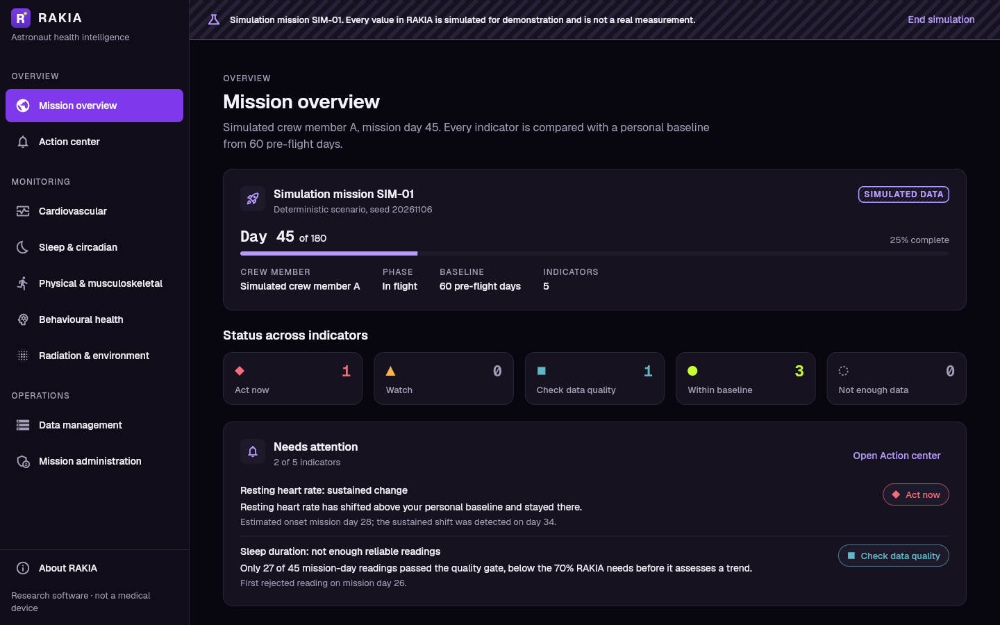
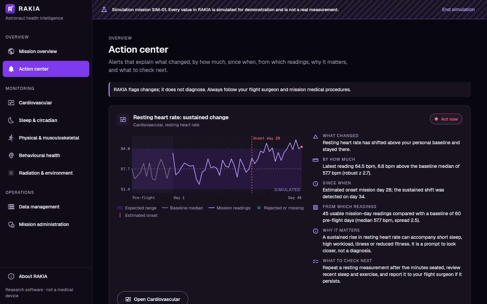
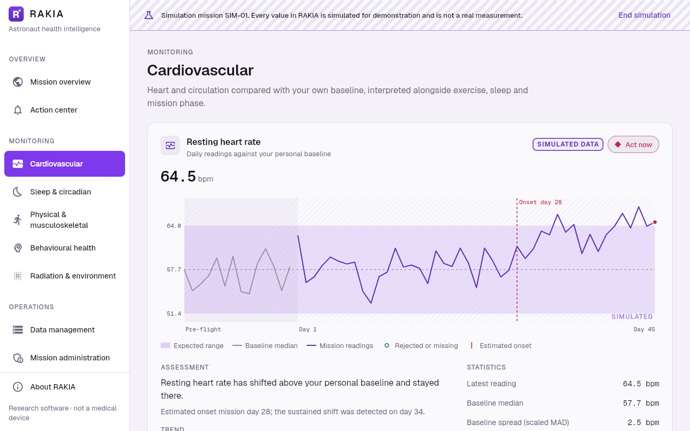
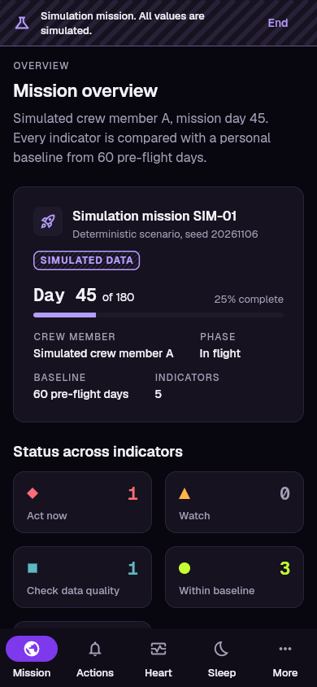
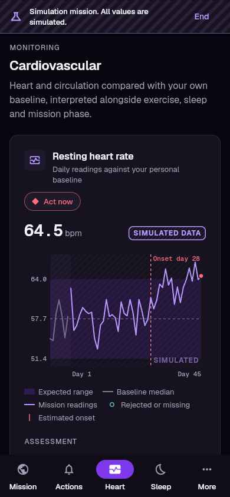

# RAKIA

**Offline-first, explainable astronaut health intelligence for long-duration space missions.**

RAKIA helps astronauts see how their own physiology and wellbeing are changing during a mission. It compares each reading with that astronaut's own baseline, explains every alert in plain language, and keeps working when contact with Earth is delayed or lost.

Built for the [NASA Space Apps Challenge 2026](https://www.spaceappschallenge.org/) (Amaravati, Andhra Pradesh, India · host: VIT-AP University), challenge *Astronaut Biosecurity: Developing a Space Health Monitoring System for Long-Duration Missions*.

> [!IMPORTANT]
> **RAKIA is research software. It is not a medical device, it does not diagnose, and its anomaly detection is experimental and not clinically validated.** It does not replace flight surgeons or medical professionals. RAKIA is not affiliated with or endorsed by NASA, ESA, CSA, or any space agency.

## Project status

**Phase 5 (core implementation).** Working today:

- The Flutter app on web, Android, iOS, Windows, macOS and Linux, with the mission dashboard, explainable alerts and the monitoring modules, running on a clearly labelled **simulation mission**.
- The `librakia` analytics core, natively through `dart:ffi` and in the browser as WebAssembly.
- An offline-first on-device store: SQLite, a hash-chained ledger that is re-verified on every load, and encryption at rest on native platforms.
- The PostgreSQL schema, with row-level security, the simulation firewall and an audit log.
- The C++ API skeleton (health, readiness, reference data), with a container image and a deployment guide.

Sign-in, mission administration, ingest of real measurements and sync need a Firebase project and Turnstile keys, and are next. Live progress is in [PROJECT_STATUS.md](PROJECT_STATUS.md).

The screenshots show the built-in **simulation mission**. Every value in it is simulated and labelled as such, and every status, baseline, onset and trend is computed by `librakia`.



| Action center | Cardiovascular, light theme |
|---|---|
|  |  |

| Phone: mission overview | Phone: cardiovascular |
|---|---|
|  |  |

## What makes RAKIA different

RAKIA does not claim to be the first astronaut-health tool. It combines known techniques in a way built for crew self-assessment:

1. **Two references for every reading.** Each value is compared with the astronaut's own baseline *and* the mission context: phase, exercise, sleep shift and workload.
2. **One deterministic analytics core.** A portable C library, `librakia`, gives identical results on the crew's device (native or WebAssembly) and on the ground server.
3. **Tamper-evident, delay-tolerant data.** Measurements form a hash-chained, append-only ledger. Store-and-forward sync shows the crew exactly what the ground has received.
4. **Alerts that fire only on good data and say when the change began.** Every alert answers: what changed, by how much, since when, from which readings, why it matters, and what to do next.
5. **A closed self-check loop.** Alerts propose a confirmatory check. The result is re-analysed and the outcome is logged.
6. **Crew-controlled privacy.** Behavioural and mood data stays on the device unless the astronaut chooses to share it.
7. **A simulation firewall.** Simulated data is confined to simulation missions by database constraints and is always labelled **SIMULATED DATA**.

The reasoning and sources are in the [Research & Innovation Report](docs/research/RESEARCH_AND_INNOVATION_REPORT.md).

## Architecture at a glance

| Layer | Technology |
|---|---|
| App (Web, Android, iOS, desktop) | Flutter, offline store (SQLite/Drift) |
| Analytics core | C11 (`librakia`) via `dart:ffi` and WebAssembly |
| API service | C++20 (cpp-httplib, libpq), REST/JSON; container on Render (free plan) |
| Database | PostgreSQL 18 (dev: self-hosted; prod: Supabase Postgres + Row-Level Security) |
| Authentication | Firebase Authentication (Google, email/password) |
| Bot protection | Cloudflare Turnstile (server-side verification) |
| Web hosting | Cloudflare Pages, self-contained build with a strict Content-Security-Policy |

Details: [Architecture & Database Design](docs/architecture/ARCHITECTURE.md) · [Design System](docs/design/DESIGN_SYSTEM.md)

## Getting started

Prerequisites and details for every component are in [docs/DEVELOPMENT.md](docs/DEVELOPMENT.md). The short version, from the repository root:

```bash
# The app (simulation mission included) on this desktop; for -d chrome, first
# build the WebAssembly modules as described in DEVELOPMENT.md
cd app && flutter pub get && flutter run -d windows   # or -d macos, -d linux
```

```bash
# Tests: analytics core, app, database, API
cmake -S core -B build && cmake --build build && ctest --test-dir build
(cd app && flutter test)
(cd db && dart test)           # database tests need a disposable database; see DEVELOPMENT.md
cmake -S server -B server/build && cmake --build server/build && ctest --test-dir server/build
```

```bash
# Local database and API (PostgreSQL 16+ running locally)
sh db/bootstrap/bootstrap-local.sh          # Windows: powershell -File dbootstrapootstrap-local.ps1
(cd db && dart pub get && dart run bin/migrate.dart up)
./server/build/rakia-api                    # then: curl http://127.0.0.1:8080/v1/ready
```

Deploying the database, the API (Render), the web app (Cloudflare Pages) and the native apps: [docs/DEPLOYMENT.md](docs/DEPLOYMENT.md).

## Documentation

| Document | Purpose |
|---|---|
| [docs/research/RESEARCH_AND_INNOVATION_REPORT.md](docs/research/RESEARCH_AND_INNOVATION_REPORT.md) | Scientific background, sources, originality assessment |
| [docs/architecture/ARCHITECTURE.md](docs/architecture/ARCHITECTURE.md) | System, API, sync, security, database, deployment |
| [docs/design/DESIGN_SYSTEM.md](docs/design/DESIGN_SYSTEM.md) | Colour tokens, typography, layout, accessibility, motion |
| [docs/DEVELOPMENT.md](docs/DEVELOPMENT.md) | Installation, local development, testing, deployment environments |
| [docs/DEPLOYMENT.md](docs/DEPLOYMENT.md) | Database, API, web and native deployment, step by step |
| [docs/api/openapi.yaml](docs/api/openapi.yaml) | API description (OpenAPI 3.1) |
| [docs/ROADMAP.md](docs/ROADMAP.md) | Phased roadmap |
| [docs/KNOWN_LIMITATIONS.md](docs/KNOWN_LIMITATIONS.md) | What RAKIA cannot do and why |
| [CONTRIBUTING.md](CONTRIBUTING.md) · [SECURITY.md](SECURITY.md) · [CODE_OF_CONDUCT.md](CODE_OF_CONDUCT.md) · [CHANGELOG.md](CHANGELOG.md) | Community and policy |

## Data principles

- Every measurement records its **source, timestamp (UTC), unit (UCUM), method** (measured, manual, estimated or derived) and **provenance** (real, imported or simulated).
- Real and simulated data are never mixed.
- No personal health information is ever committed to this repository.

## Licence

[Apache License 2.0](LICENSE). It was chosen for its explicit patent grant, which suits health and research software that others may build on. Third-party design references used during development (all MIT-licensed) were used as knowledge only; no code or assets were copied.
